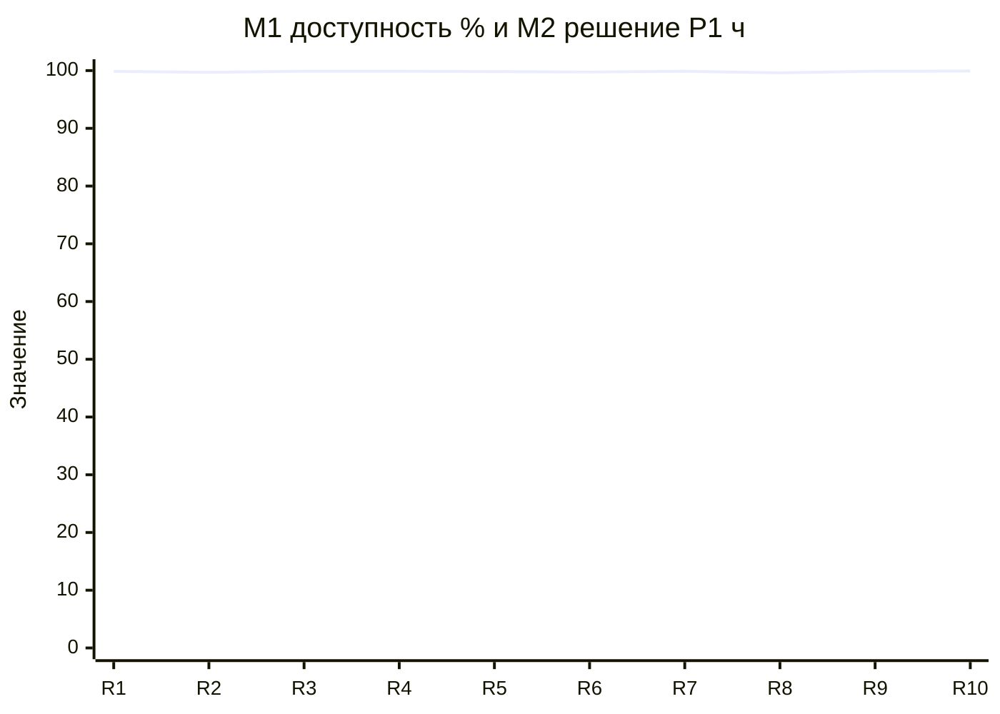

# Практическая работа №3. 10 релизов / SLA как контракт команды

Курс: Управление информационными технологиями на предприятии (ITIL), осень/зима 2026.

Точка отсчёта: текущий контур терминала D после ПР1-ПР2 и лебедей 30, 35, 27, 41. Новый продукт не выбираю. Релизы - будущая траектория на ~9 месяцев (режим миграции платформы из лебедя 41).

Примечание: реакция на 27/41 ушла в Git после окна проверки на паре; долг на реакцию закрываю дожимом процедур H/I и отчётности top-заказчикам в R1-R2.

## Шапка (из паспорта)

| Поле | Значение |
| --- | --- |
| Продукт и тип бизнеса | АО «МАШ» (Шереметьево), аэропортовый оператор |
| Разбираемый ИТ-сервис | Операционное обслуживание рейсов в терминале D (данные рейса + багаж) |
| Годовой оборот и способ подтверждения | Факт 26,9 млрд ₽ (РСБУ 2021); оценка для расчётов ~38 млрд ₽ |
| Пользователи и нагрузка | Авиакомпании D; ~190 операций/сутки по D (оценка); пик лето |
| Режим данных | Смешанный: факты из публикаций + оценки с формулами |

---

## 1. Стартовый состав команды

Оценка штата контура ~12-15 (паспорт). Стоимость - оценка рынка Москва/аэропорт, ₽/мес на человека (gross для курса).

| Роль | Чел. | Зона | ₽/мес (оценка) | ФОТ/мес |
| --- | --- | --- | --- | --- |
| Руководитель ИТ-контура | 1 | иерархия, бюджет, найм | 350 000 | 350 000 |
| Владелец сервиса D | 1 | SLA, заказчики, аварийный режим, кредиты | 280 000 | 280 000 |
| Инженер интеграций «Синхрон» | 2 | канал данных, dual-run, on-call | 220 000 | 440 000 |
| Дежурный СОБ (АСУ ТП) | 7 | железо/PLC, ТО, урезанный багаж, 2/2 | 180 000 | 1 260 000 |
| Дежурный мониторинг | 1 | алерты, тикеты, первая реакция | 160 000 | 160 000 |
| **Итого свой штат** | **12** | | | **~2,49 млн** |

Подрядчики (не в ФОТ, оценка контракта/мес): Рексофт ~400 тыс.; вендор железа по заявкам; подрядчик новой платформы интеграций с R2 ~500 тыс. на период миграции.

**Изменения штата по релизам**

| Релиз | Изменение | Причина |
| --- | --- | --- |
| R3 | +0,5 FTE мониторинга (совмещение с интеграциями до найма) | очередь алертов dual-run |
| R7 | +2 инженера интеграций (план лебедя 35) | выход найма; онбординг |
| R8 | подрядчик новой платформы +1 выделенный слот на cutover (2 мес.) | cutover волны 1 |
| R10 | подрядчик новой платформы → сопровождение −30% | миграция закрыта |

Штат использую явно: владелец не чинит интеграции руками; дежурный СОБ и интеграции закрывают свои процедуры из ПР2.

---

## 2. Сквозные метрики

Набор фиксирован. Меняются только целевые значения.

| ID | Метрика | Ед. | Стартовая цель (после лебедей) | Тип |
| --- | --- | --- | --- | --- |
| M1 | Доступность полного сервиса D | % / мес. | 99,9 (вне аварийного режима площадки) | SLA |
| M2 | Время решения P1 | ч | ≤4 | SLA |
| M3 | Канал данных без метки «под сомнением» | % мин. | ≥99,5 | SLA (27/35) |
| M4 | Доля неудачных развёртываний / cutover | % за релиз | ≤10 | инж. |
| M5 | MTTR полного простоя (факт) | ч | ≤4 (урезанный ≤8 при лебеде 30) | инж. |
| M6 | Обращения в поддержку на 1000 операций рейса D | шт. | ≤8 (оценка) | продукт |

---

## 3. Таблица 10 релизов

Горизонт по умолчанию 3 недели; отклонения пояснены. Операций/сутки ~190 → ~4000 операций за 3 недели (оценка) для пересчёта M6.

| R | Горизонт | Цель релиза (бизнес + показатель) | Состав работ (роли) | SLA целевой | SLA факт | Отклонение |
| --- | --- | --- | --- | --- | --- | --- |
| 1 | 3 нед. | Снять долг по целостности данных; M3 ≥99,5; закрыть H/G для top-2 | Контроль целостности на выходе; уведомления top-2; known error (интеграции, владелец, мониторинг) | M1 99,9; M2 4; M3 99,5; M4 10; M5 4; M6 8 | M1 99,85; M2 3,5; M3 99,2; M4 5; M5 3,5; M6 11 | M3/M6 хуже: ловим хвосты 27; пожертвовали объёмом (фичи dual-run сдвинули) |
| 2 | 3 нед. | Пилот dual-run новой платформы интеграций; M4 ≤15 на пилоте | Стенд dual-run; сверка контуров; обучение смены (интеграции, владелец, подрядчик платформы) | M1 99,9; M2 4; M3 99,5; M4 15; M5 4; M6 9 | M1 99,7; M2 4,2; M3 99,4; M4 20; M5 4,5; M6 10 | Пилот сыпется; M4 пробит; срок R3 +3 дня |
| 3 | 3 нед. (+3 дня) | Автоматизация SR/STD; M6 ≤7 | Шаблоны SR-01, STD-01..03; бот маршрутизации P3/P4 (мониторинг, интеграции) | M1 99,9; M2 4; M3 99,6; M4 10; M5 4; M6 7 | M1 99,88; M2 3,8; M3 99,55; M4 8; M5 3,8; M6 7,5 | Почти цель; часть скриптов сырая |
| 4 | 3 нед. | Резерв площадки с актом (долг 30); готовность урезанного ≤8 ч подтверждена | SR-05 полный прогон; дозакуп узлов резерва; чеклист C (СОБ, владелец, вендор) | M1 99,9; M2 4; M3 99,6; M4 10; M5 4 / урез. 8; M6 7 | M1 н/п 2 сут. (учения); M2 4; M3 99,6; M4 12; M5 урез. 6; M6 8 | Учение съело окно; M6 чуть хуже |
| 5 | 4 нед. (пик) | Пик лета без просадки M1; окна cutover ≤8 ч/мес. | Лимиты окон; усиление смены СОБ; запрет мажорного cutover в пик (владелец, СОБ, интеграции) | M1 99,9; M2 4; M3 99,6; M4 10; M5 4; M6 9 | M1 99,82; M2 5; M3 99,5; M4 5; M5 5; M6 12 | Нагрузка; P1 дольше; M6 вырос |
| 6 | 3 нед. | Стабильный dual-run при смене схемы DCS top-заказчика | Интеграционные тесты на стыке; процедура разграничения B/H (интеграции, владелец, авиакомпания) | M1 99,9; M2 4; M3 99,7; M4 10; M5 4; M6 8 | M1 99,75; M2 6; M3 98,9; M4 18; M5 6; M6 14 | Стык DCS; окно «под сомнением»; жертва сроком |
| 7 | 4 нед. (онборд.) | +2 инженера в строю; on-call без дыр; M2 ≤4 ночью | Онбординг; парное дежурство; актуализация runbook (интеграции, владелец) | M1 99,9; M2 4; M3 99,6; M4 10; M5 4; M6 8 | M1 99,9; M2 4,5; M3 99,55; M4 10; M5 4; M6 9 | Новички +1 ч к P1 две недели |
| 8 | 3 нед. | Cutover волны 1 данных на новую платформу без полного простоя >4 ч | Чеклист I; откат ≤4 ч; dual-run prod (владелец, интеграции, подрядчик, мониторинг) | M1 99,9; M2 4; M3 99,5; M4 10; M5 4; M6 9 | M1 99,6; M2 4; M3 99,1; M4 25; M5 3,2 (откат); M6 13 | Cutover откатили частично; качество/объём урезаны |
| 9 | 3 нед. | Мониторинг новой платформы = пороги ПР2; ложные алерты −50% | Перенос синтетики; пороги целостности; STD-01 (мониторинг, интеграции) | M1 99,9; M2 4; M3 99,6; M4 10; M5 4; M6 8 | M1 99,88; M2 3,5; M3 99,65; M4 8; M5 3,5; M6 7 | Цели почти взяты |
| 10 | 3 нед. | Закрытие миграции; нормализация SLA с top-2; M1/M3 как в договоре | Акт cutover done; снятие dual-run; пересмотр приложения к SLA (владелец, руководитель, top-2) | M1 99,9; M2 4; M3 99,7; M4 5; M5 4; M6 6 | M1 99,91; M2 3,5; M3 99,72; M4 5; M5 3,5; M6 6 | Цели достигнуты |

---

## 4. Лебеди, реакция, превентив по релизам

### R1. Целостность после 27

**Лебедь:** источник - люди/техдолг. В середине спринта повторное расхождение контрольных полей на 8% рейсов D за 40 мин (хвост той же ошибки обработки). M3 падает; M6 растёт. Правдоподобно: после «починили за час» не дожали карту распространения.

**Реакция:** мониторинг ловит порог целостности → процедура H; владелец пишет top-2 ≤30 мин; интеграции останавливают сомнительную выдачу; проблема G. Жертва: объём (старт dual-run сдвинут на R2).

**Превентив:** обязательная сверка целостности в CI выкладки интеграций; стоимость ~40 чел.-ч интеграций (~0,2 ставки на R2-R3).

### R2. Пилот dual-run

**Лебедь:** источник - техника. Расхождение старого и нового контура > порога; ложный cutover на стенде. M4=20%, M2 чуть хуже из-за отвлечения on-call.

**Реакция:** процедура I (стоп несанкционированного cutover); владелец; подрядчик. Жертва: срок (+3 дня к R3) и бюджет подрядчика (+оценка 150 тыс. на доработку сверки).

**Превентив:** авто-сверка dual-run каждые 5 мин + тикет при расхождении; ~60 чел.-ч + доработка подрядчика.

### R3. Автоматизация SR/STD

**Лебедь:** источник - люди. Скрипт маршрутизации помечает часть P2 как SR; очередь «тихо» растёт. M6 не дотягивает до 7.

**Реакция:** мониторинг + владелец; откат скрипта (STD/срочное E); правка каталога. Жертва: качество автоматизации (выкатили урезанный бот).

**Превентив:** правило «бот не трогает P1/P2»; ревью владельцем 1 раз/спринт (~8 чел.-ч/релиз).

### R4. Резерв площадки

**Лебедь:** источник - внешний поставщик/площадка. На учении SR-05 вендор не привёз узел вовремя; урезанный подняли за 6 ч (в норме), но M6 подскочил из-за ручного багажа.

**Реакция:** процедура C; СОБ; владелец; вендор. Жертва: бюджет (срочная доставка ~оценка 300 тыс.) и объём фич R5.

**Превентив:** складской минимум 2 критичных узла; контракт SLA с вендором на срок поставки; +оценка 200 тыс./кв. в бюджете.

### R5. Пик лета

**Лебедь:** источник - рынок/нагрузка. Операций/сутки ~1,4× от базы 3 дня подряд; P1 по багажной линии; M2=5 ч, M6=12.

**Реакция:** матрица приоритетов ПР2; СОБ на урезанном участке; владелец запрещает мажорный cutover. Жертва: объём (миграционные задачи freeze) и срок миграции (+1 нед. в плане 41).

**Превентив:** календарь «no major cutover» на пик; стоимость - сдвиг R8.

### R6. Стык DCS

**Лебедь:** источник - внешний поставщик. Top-заказчик меняет схему DCS без окна; dual-run расходится; метка «под сомнением» 6 ч; M3=98,9.

**Реакция:** H + B (разграничение наш/DCS); владелец эскалирует заказчику; интеграции. Жертва: срок (R7 старт с задержкой) и качество (часть рейсов на ручной сверке).

**Превентив:** письменный порядок изменений на стыке в приложении к SLA; интеграционные тесты до приёмки схемы заказчика (~50 чел.-ч, долг «стык» в регламенте закрыт).

### R7. Найм +2

**Лебедь:** источник - люди. Новички на on-call; 2 ложных эскалации; M2=4,5 средняя за период.

**Реакция:** парное дежурство со старшим интеграций; владелец не микроменеджит инциденты, держит приоритеты. Жертва: бюджет ФОТ (+440 тыс./мес с R7) и срок обучения.

**Превентив:** чеклист допуска к on-call (14 дней тень); runbook актуализация до выхода в соло (~20 чел.-ч).

### R8. Cutover волны 1

**Лебедь:** источник - техника. После cutover мониторинг новой платформы молчит 25 мин; частичный откат по I; M4=25%, M1 за сутки просел.

**Реакция:** срочное E + I; владелец; подрядчик; мониторинг. Жертва: качество (остались на гибриде) и объём волны 2.

**Превентив:** запрет cutover без зелёного чеклиста мониторинга 24 ч на новой платформе; доп. слот подрядчика 2 мес. (~1 млн оценка).

### R9. Регресс мониторинга

**Лебедь:** источник - техника. После починки пороги слишком жёсткие; 40 ложных P2 за неделю; выгорание смены, M6 временно растёт потом падает после STD-01.

**Реакция:** STD-01 (мониторинг); владелец утверждает диапазон. Жертва: краткосрочно качество сигналов.

**Превентив:** недельный разбор ложных алертов в процедуре мониторинга (~4 чел.-ч/нед.).

### R10. Закрытие миграции

**Лебедь:** источник - регулирование/контракт. Top-2 требуют акт независимого аудита cutover и пересмотр приложения к SLA за 10 раб. дней (триггер из 35).

**Реакция:** F + владелец + руководитель; данные по M1-M3 за миграцию; согласованный акт. Жертва: бюджет аудита (оценка 0,5-1 млн, за счёт заказчика или сметы по SLA) и время владельца.

**Превентив:** ежемесячный пакет метрик миграции в отчёт F до конца dual-run (уже заложено; трудозатраты ~8 чел.-ч/мес.).

---

## 5. Анализ динамики

### 5.1. Сводка факта по релизам

| R | M1 % | M2 ч | M3 % | M4 % | M5 ч | M6 |
| --- | --- | --- | --- | --- | --- | --- |
| 1 | 99,85 | 3,5 | 99,2 | 5 | 3,5 | 11 |
| 2 | 99,7 | 4,2 | 99,4 | 20 | 4,5 | 10 |
| 3 | 99,88 | 3,8 | 99,55 | 8 | 3,8 | 7,5 |
| 4 | 99,9* | 4 | 99,6 | 12 | 6 урез. | 8 |
| 5 | 99,82 | 5 | 99,5 | 5 | 5 | 12 |
| 6 | 99,75 | 6 | 98,9 | 18 | 6 | 14 |
| 7 | 99,9 | 4,5 | 99,55 | 10 | 4 | 9 |
| 8 | 99,6 | 4 | 99,1 | 25 | 3,2 | 13 |
| 9 | 99,88 | 3,5 | 99,65 | 8 | 3,5 | 7 |
| 10 | 99,91 | 3,5 | 99,72 | 5 | 3,5 | 6 |

\*R4: минуты учения/урезанного учтены по правилам лебедя 30, не как обычный простой.

### 5.2. График ключевых метрик

```text
M3 канал данных без сомнения (%), цель ≥99,5
R1  99.2  ####
R2  99.4  #####
R3  99.55 ######
R4  99.6  ######
R5  99.5  #####
R6  98.9  ###      ← стык DCS
R7  99.55 ######
R8  99.1  ####     ← cutover
R9  99.65 ######
R10 99.72 #######

M6 обращений / 1000 операций (меньше лучше), цель ≤8 к концу
R1  11 ###########
R2  10 ##########
R3  7.5 #######
R4  8 ########
R5  12 ############
R6  14 ##############
R7  9 #########
R8  13 #############
R9  7 #######
R10 6 ######
```



(Для M2 на том же горизонте факт: 3.5 → 4.2 → 3.8 → 4 → 5 → 6 → 4.5 → 4 → 3.5 → 3.5 ч.)

### 5.3. Выводы

1. **Разрыв цель/факт** максимален на R6 (стык DCS) и R8 (cutover): M3 и M4 проседают вместе. Превентивы R6/R8 дорогие, но к R10 M3/M1 в цели.
2. **Trade-off:** в пик (R5) и на cutover (R8) держим M1 ценой M6 и сдвига миграции. Автоматизация R3 улучшает M6, пока люди/внешние стыки снова не раздувают очередь.
3. **Пересмотр целевого SLA:** после R6 подняли цель M3 до 99,7 к R10 и ужесточили порядок стыка в приложении; после R8 не смягчали M1 (оставили 99,9), зато явно запретили cutover без чеклиста I - внутренний контракт команды жёстче внешнего обещания «успеем к дате».
4. **Штат как ресурс:** +2 инженера (R7) и слот подрядчика (R8) видны в ФОТ и в улучшении M2 к R9-R10. Владелец не тушит P1 сам.
5. **Связь с ПР2:** H, I, C, B, G, E, F, STD использованы; пробел «порядок изменений на стыке с DCS» закрыт превентивом R6 (раньше в регламенте был только шаг разграничения в B).
6. **Устойчивость:** за 10 релизов прошли >2 кризиса (R6+R8) без снятия базового SLA; миграция 41 уложилась в горизонт ценой сдвигов и гибрида на R8.

---

## 6. Источники

1. Notion, ПР3: https://www.notion.so/3-10-SLA-3dbf48e66bb681a3baaad2f65d5ec17b  
2. Паспорт проекта.md  
3. Практическая работа 1.md; Практическая работа 2.md  
4. Лебеди 30 и 35.md; Лебеди 27 и 41.md  
