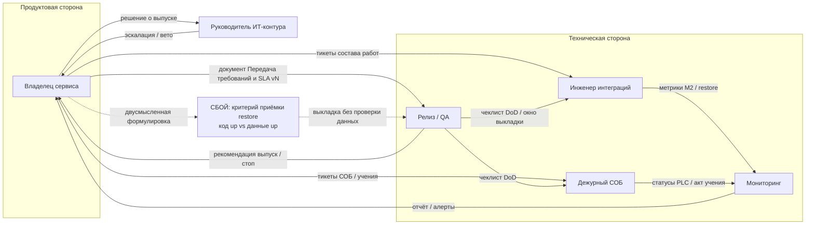

# Практическая работа №4. Передача между продуктом и техникой

Курс: Управление информационными технологиями на предприятии (ITIL), осень/зима 2026.

Опираюсь на релизы из `Практическая работа 3.md`, роли и процедуры из `Практическая работа 2.md`, внешний SLA из `Практическая работа 1.md`. Срывы чаще сидят на границе команд, а не в коде: ниже три пары передач, внутренний SLA техники и сбой коммуникации на стыке R5→R6.

## Шапка (из паспорта)

| Поле | Значение |
| --- | --- |
| Продукт и тип бизнеса | АО «МАШ» (Шереметьево), аэропортовый оператор |
| Разбираемый ИТ-сервис | Операционное обслуживание рейсов в терминале D (данные рейса + багаж) |
| Годовой оборот и способ подтверждения | Факт 26,9 млрд ₽ (РСБУ 2021); оценка для расчётов ~38 млрд ₽ |
| Пользователи и нагрузка | Авиакомпании D; ~190 операций/сутки по D (оценка); пик лето |
| Режим данных | Смешанный: факты из публикаций + оценки с формулами |

**Роли на границе (из ПР2):** владелец сервиса = продуктовая сторона передачи; инженер интеграций «Синхрон», инженер релиза/QA, дежурный СОБ, мониторинг = техническая сторона; руководитель ИТ-контура = эскалация и решение о выпуске при споре.

---

## 1. Пары итераций и переход X → X+1

Три пары **не подряд**, разные ситуации. Все релизы есть в таблице ПР3.

| Пара | Тип | Что переходит из X в X+1 |
| --- | --- | --- |
| **R2 → R3** | спокойная | см. ниже |
| **R4 → R5** | сжатые сроки | см. ниже |
| **R5 → R6** | после инцидента | см. ниже |

### Пара A. R2 → R3 (спокойная)

После блокера резерва «Синхрон» (лебедь ПР3 №2) контур относительно ровный: пайплайн резерва уже Done, можно спокойно передать доступы и добивку M2.

| Вид | Переходящее (номера из ПР3) |
| --- | --- |
| Задачи | Полировка дашборда M2, сдвинутая с R2 на R3; каталог SR-06/07/08 и автоотзыв ≤7 дн.; старт ревизии прав 90 дн. |
| Техдолг | Налог раскатки резерва **+6 чел.-дн.** на каждый релиз, трогающий справочники; контрактный хвост срока патча Рексофт (превентива R2) |
| Дефекты | Открытых P1 нет; лёгкий хвост CFR по срочным выкладкам резерва (M4 факт R2 = 14% при цели 12%) |
| Обещания SLA | Довести факт M2 к **99,5**; цель R3: M4 **≤10%**, M6 **≤7,0**, M5 = 2/квартал |

### Пара B. R4 → R5 (сжатые сроки)

Перед пиком лета и сезоном с **28.03.2027**: окно узкое, объём нельзя размазать.

| Вид | Переходящее |
| --- | --- |
| Задачи | Недоделанная часть маршрутов сортировки под новую сетку (СОБ + Рексофт); усиление мониторинга PLC; учения урезанного багажа B/C; буфер on-call 2 интегратора на пиковые сутки |
| Техдолг | Превентива ёмкости (+4 чел.-дн. из R4); очередь срочных доступов отдельно от P1 |
| Дефекты | M3 факт R4 = **250** мин (цель 240); M6 = **7,8** при цели 7,0; M1 = 99,86 |
| Обещания SLA | Удержать **M1 ≥ 99,9** и **M3 ≤ 240** при ~+25% операций к зиме; цель M6 **≤6,5** |

### Пара C. R5 → R6 (после инцидента)

После прошивки PLC: полный простой **~2,1 ч**, M1 факт **99,78**, M3 **280**, M4 **16%**, M6 **8,5**.

| Вид | Переходящее |
| --- | --- |
| Задачи | Учение restore и изолированный бэкап (лебедь ПР3 №6); жёсткая передача смены в тикетах; откат-план на выкладки СОБ; стенд прошивок PLC (~180 тыс. ₽ + 5 чел.-дн.) |
| Техдолг | Known error по сортировке; сдвинутый runbook ночных окон (осознанно уступил приоритет restore) |
| Дефекты | Невыполненная цель M1/M3/M4/M6 пика; риск повторной прошивки без стенда |
| Обещания SLA | R6: M4 **≤8%**; M3 **≤240** при критерии «P1 закрыт только когда есть данные»; RTO данных урезанного контура **≤8 ч** |

---

## 2. Процесс передачи задач

### 2.1. Состав передаваемого

Владелец сервиса передаёт технической стороне в одном пакете:

| Поле | Содержание |
| --- | --- |
| Цель | бизнес-задача релиза и какой показатель M1-M6 должен сдвинуться |
| Ограничения | окна ТО, КИИ/согласования, зависимость от Рексофт/вендора/DCS, минимум смены |
| Критерии приёмки | проверяемые условия Ready/Done, в т.ч. ошибки и границы |
| Приоритеты | что режем первым при нехватке часов (срок / объём / качество / бюджет) |
| Нагрузка | оценка операций/сутки, пик, доля top-заказчиков |
| Наблюдаемость | какие метрики/алерты обязаны гореть после выкатки; точка наблюдения (для данных: выход «Синхрон»→DCS) |

### 2.2. Формат и канал

| Элемент | Правило |
| --- | --- |
| Артефакт | документ «Передача требований и SLA» (шаблон ниже) + тикеты на элементы состава работ |
| Где живёт | wiki/тикет-система контура D; версия в журнале изменений |
| Владелец документа | владелец сервиса |
| Изменения после старта разработки | только через **обычное/срочное изменение** (ПР2, §1.3) с новой версией документа; устное «давайте ещё вот это» не принимается |
| Ритуал handoff | на стыке итераций: владелец + релиз/QA + интеграции; если трогаем СОБ - дежурный СОБ / старший смены. Фиксация: все подписали версию N в тикете handoff |

### 2.3. SLA технической команды (внутренний)

Обеспечивает внешний SLA ПР1 (P1 15 мин / 4 ч; плановые окна; RTO).

| Обязательство | Цель | Кто |
| --- | --- | --- |
| Оценка задачи после handoff | ≤ **2 раб. дн.** | интеграции / СОБ / релиз (по зоне) |
| Ревью спеки/PR / чеклиста выкладки | ≤ **1 раб. дн.** | релиз/QA (+ второй инженер) |
| Сборка + выкладка в согласованное окно | ≤ **4 ч** внутри окна | релиз + зона |
| Откат после неудачной выкладки | ≤ **1 ч** | релиз + зона; процедура E |
| Первый ответ на блокер handoff («непонятна приёмка») | ≤ **4 раб. ч** | владелец сервиса |

**Арифметика с внешним SLA.** Путь «оценка → ревью → выкладка» = до 2+1 раб. дн. + окно ≤4 ч - это путь **планового** изменения, не путь P1. Инцидент P1 идёт по процедуре A (реакция ≤15 мин, решение ≤4 ч) и **не ждёт** оценки 2 дня. Плановое окно ≤4 ч/мес. с предупреждением ≥48 ч (в аварии площадки ≥24 ч) согласовано с «выкладка ≤4 ч в окне». Откат ≤1 ч укладывается в бюджет решения P1 4 ч, если выкладка породила инцидент.

Если сумма внутренних сроков на плановую фичу не влезает в горизонт релиза - режем объём на handoff, а не молча сдвигаем внешний P1.

---

## 3. Документы «Передача требований и SLA»

### Документ 1. Пара R2 → R3 (спокойная)

**1. Общая цель.** Закрыть хаос доступов (лебедь 27) и добить наблюдаемость канала данных после резерва. Показатели: M2 → факт около **99,5%**; M6 → **≤7,0**; M4 → **≤10%**.

**2. Ключевые функции и критерии приёмки.**

| Функция | Ready / Done (проверяемо) | Ошибки и границы |
| --- | --- | --- |
| Каталог SR-06/07/08 | В тикет-системе три типа доступа; срочный только при открытом P1/P2 или письме владельца | Заявка без роли/срока - отклонена, работа не стартует |
| Автоотзыв ≤7 дн. | Временный доступ без даты окончания создать нельзя; алерт за 24 ч до отзыва | Продление = новый SR, не «продлить молча» |
| Дашборд M2 | На дашборде доля минут с задержкой ≤5 мин на выходе «Синхрон»→DCS; порог алерта задан | Нет данных с точки наблюдения 15 мин → алерт, не «зелёный по API up» |
| Резерв при правке справочников | В составе работ строка раскатки+сверки; Done без неё запрещён | Сверка красная → урезанный режим не объявлять «готовым» (процедура C) |

**3. Целевые метрики SLA после выкатки R3.** M1 **99,9%**; M2 **99,5%**; M3 **240** мин p90; M4 **≤10%**; M5 **2**/квартал; M6 **≤7,0**.

**4. Ответственность и выпуск.**

| Критерий | Исполняет | Принимает |
| --- | --- | --- |
| SR-доступ / автоотзыв | интеграции | владелец |
| Дашборд M2 | мониторинг + интеграции | владелец |
| Резерв+сверка | интеграции + релиз/QA | релиз/QA (DoD) |
| **Решение о выпуске R3** | | **владелец сервиса**; при споре о DoD резерва - руководитель контура |

**5. Риски и меры.** Срыв сроков владельцев данных → таймер SR не крутится до ответа (уже в лебеде 27). Всплеск «срочных» доступов → отдельная очередь, не P1. Рексофт тянет патч → эскалация supplier, не ломаем Done резерва обходом без сверки.

---

### Документ 2. Пара R4 → R5 (сжатые сроки)

**1. Общая цель.** Удержать сервис на пике лета (~+25% операций к зиме, оценка). Показатели: **M1 ≥ 99,9%**, **M3 ≤ 240** мин, M6 **≤6,5**.

**2. Ключевые функции и критерии приёмки.**

| Функция | Ready / Done | Ошибки и границы |
| --- | --- | --- |
| Мониторинг PLC/конвейеров | Алерты по ключевым шкафам в проде; runbook дежурного СОБ обновлён | Ложный алерт >N/сутки - порог пересматривает мониторинг+СОБ, не молча глушим |
| Учение урезанного багажа B/C | Акт учения: ёмкость, список рейсов-кандидатов, контакты | Без акта процедуру C на пике не считаем отработанной |
| On-call интеграций ×2 в пиковые сутки | График на календарь пика; дублёр назван | Один человек в графике = не Ready |
| Маршруты сортировки под сетку | Критичный набор маршрутов в проде; остаток явно в бэклоге R6+ | «Почти все маршруты» без списка - не Done |

**3. Целевые метрики.** M1 **99,9**; M2 **99,5**; M3 **240**; M4 **≤10**; M5 **2**; M6 **≤6,5**. Плановые окна только вне волны вылетов, предупреждение ≥48 ч.

**4. Ответственность и выпуск.** СОБ - железо/учения; интеграции - on-call и канал данных; владелец - приоритет рейсов при урезанном; релиз/QA - окна. **Решение о выпуске R5:** владелец; если коммерция давит на объём без on-call - руководитель контура вправе остановить выкладку.

**5. Риски и меры.** Внеплановый прирост слотов (как в R4) → сверка сетки до выкладки. Прошивка в пик → запрет без стенда (урок R5). Нехватка часов → режем маршруты «nice to have», не on-call и не мониторинг PLC.

---

### Документ 3. Пара R5 → R6 (после инцидента)

**1. Общая цель.** После простоя PLC вернуть управляемость выкладок и доказать restore **данных**, не только кода (лебедь ПР3 №6). Показатели: M4 **≤8%**; M3 **≤240** при правильном закрытии P1; учение: RTO данных урезанного контура **≤8 ч**.

**2. Ключевые функции и критерии приёмки.**

| Функция | Ready / Done | Ошибки и границы |
| --- | --- | --- |
| Изолированный бэкап конфигов/ключей и среза оперативных данных | Копия вне той же сети, что прод и горячая реплика; дата успешного тестового restore | «Реплика в том же сегменте» = не Ready |
| Учение restore | Протокол: время подъёма кода; время появления данных у заказчика на контрольном рейсе | Код up за 3 ч при данных >8 ч = **учение провалено**, P1-критерий не выполнен |
| Передача смены только в тикете | Чеклист в тикете; устная передача = нарушение | Инцидент «потерялся» на пересменке - эскалация владельцу |
| Откат-план на выкладку СОБ | В тикете изменения есть шаг отката ≤1 ч | Выкладка без отката - релиз/QA не подписывает |
| Стенд прошивок PLC | Прошивка сначала на стенде; в пиковые сутки в прод - запрет | Повтор R5 без стенда = блокер |

**3. Целевые метрики.** M1 **99,9**; M2 **99,5**; M3 **240** (закрытие только при данных); M4 **≤8**; M5 **2**; M6 **≤6,5**. Письменно для заказчиков: RTO кода ≤4 ч; RTO данных урезанного контура ≤8 ч.

**4. Ответственность и выпуск.** Интеграции + мониторинг - бэкап/restore; СОБ - смена и откат железа; релиз/QA - DoD выкладки; владелец - формулировка приёмки и коммуникация. **Решение о выпуске R6:** владелец; **релиз/QA имеет право вето**, если нет успешного пункта restore данных в чеклисте.

**5. Риски и меры.** Двусмысленный «restore готов» (см. §5) → явная формулировка в документе. Конфликт смен → аудит передач. Давление «успеть к дате» → режем runbook ночных окон, не бэкап.

---

## 4. Схема взаимодействий

Точка сбоя: стрелка приёмки между владельцем и релиз/QA на паре R5→R6 (подробности в §5).

---

## 5. Чёрный лебедь в коммуникации (R5 → R6)

Это не «упал сервер». Ломается **взаимодействие**.

**Где потерялась информация.** В документе передачи R5→R6 критерий «учение restore / P1-контур готов» записан коротко: «восстановление за целевое время». Владелец (продукт) читает как в учении Notion: код и релизы из офлайн-копий за **~3 ч**. Техника (интеграции + релиз/QA) молча держит в голове формулировку лебедя ПР3 №6 и ПР3: готово = заказчик снова видит **оперативные данные** (RTO данных ≤8 ч). На handoff никто не сверил одну фразу с двумя смыслами. Изменение приоритета «сначала бэкап данных» не зафиксировали новой версией документа.

**Как проявилось.** Релиз/QA подписал выкладку инструментов restore по факту «поды и пайплайн кода поднялись за ~3 ч». Учение на контрольном рейсе: данные и сессии интеграций из горячей реплики не поднялись в срок; полный хвост ушёл к **~48 ч** без изолированной копии (как в условии лебедя 6). Заказчик внутри группы фиксирует: «код есть, рейсовых данных нет». Открыт/продлён инцидент по правилам M3: P1 нельзя закрывать.

**На какую метрику SLA и насколько.**

| Метрика | Цель R6 | Факт / эффект | Срок |
| --- | --- | --- | --- |
| **M3** время решения P1, p90 | 240 мин | **245** мин по итогам релиза (ПР3); на сценарии «потеря хранилища без изолированной копии» решение по данным уходит за **8 ч** цели и до **~48 ч** в худшем прогоне | внутри итерации R6 (6 недель); пик проявления - день учения |
| **M2** канал данных | 99,5% | минуты «код up / данные down» должны считаться неуспешной доступностью; в отчёте R6 факт **99,38%** | те же сутки учения + хвост восстановления |
| M4 | ≤8% | **9%**: часть выкладок/учения с откатом и доработкой бэкапа | R6 |

Цепочка: двусмысленная приёмка → ложный Done → провал учения по данным → удар по **M3** (и M2).

---

## 6. Корректирующие действия

### 6.1. Перераспределение ответственности

- Релиз/QA **не подписывает Done** выкладки restore/P1-контура без чеклиста: (1) код поднят, (2) контрольный рейс видит данные, (3) изолированная копия проверена датой.
- Интеграции владеют пунктом «данные»; СОБ - железом; владелец владеет формулировкой приёмки и обязанным синком, а не «отправил документ и пропал».

### 6.2. Пересмотр SLA / критериев приёмки

- В шаблоне передачи и в целях R6+ явно два числа: **RTO кода ≤4 ч**; **RTO данных урезанного контура ≤8 ч**.
- Закрытие P1 = метрики M1/M2 на согласованном контуре, не «поды зелёные» (уже намечено в ПР3; здесь закрепляем в передаче и регламенте).

### 6.3. Качество взаимодействия

- Обязательный пункт в шаблоне: «Наблюдаемость / restore / точка измерения».
- Синк владелец ↔ интеграции ↔ релиз/QA **до** выкатки, если в релизе есть слово restore, бэкап, P1-критерий или резерв.
- Любое изменение смысла приёмки после handoff = новая версия документа через change.

### Что стало постоянным

Постоянно в регламент ПР2 уходит: **вето релиз/QA на Done без проверки данных** + **двухуровний RTO (код/данные) в критериях приёмки и процедуре A**. Разовое «провели учение ещё раз» без правки шаблона - недостаточно.

---

## 7. Изменения в регламент ПР2

| Адрес в ПР2 | Суть правки |
| --- | --- |
| §1.3 Change enablement / процедура **E** | Перед срочным/обычным изменением с выкладкой: ссылка на версию документа «Передача требований и SLA»; без версии handoff выкладка не стартует |
| Новый короткий блок после §1.3 (или приложение) | Шаблон передачи: цель, ограничения, приёмка, приоритеты, нагрузка, наблюдаемость/restore; правило версий |
| Процедура **A** (P1) | Критерий выхода: заказчик получает урезанно достаточные **данные**; код без данных = инцидент открыт |
| Процедура **C** / SR-05 | Уже связано с лебедем ПР3 №2: урезанный «готов» только при зелёной сверке резерва - оставляем, ссылаемся из шаблона приёмки |
| §4 Роли | У роли **релиз/QA**: право вето Done по чеклисту данных/резерва; эскалация руководителю при давлении на ложный выпуск |
| §6 Матрица соответствия | Строка: RTO данных / закрытие P1 → Incident + Continuity → интеграции + релиз/QA → процедуры A, E |
| Процедура **F** (отчёт SLA) | В месячном отчёте: раздельно инциденты «код up / данные down», если были |

Релизы R2-R6, роли и метрики M1-M6 совпадают с ПР3; процедуры A/C/E/F - с ПР2.

---

## 8. Самопроверка по скорингу ПР4

| Критерий | Закрыто |
| --- | --- |
| 3 пары не подряд, типы разные, переход разложен | R2→R3 / R4→R5 / R5→R6 |
| Процесс + SLA техники с числами и арифметикой к ПР1 | §2 |
| Три документа × 5 разделов, приёмка проверяемая, кто выпускает | §3 |
| Схема с ролями, артефактами, сбоем | §4 |
| Коммуникационный лебедь с цепочкой до M3 и величиной | §5 |
| Три направления корректировок + постоянное | §6 |
| Правки в ПР2 с адресом; шапка = паспорт | §7, шапка |

---

## 9. Источники

1. Notion, ПР4: https://www.notion.so/4-3dbf48e66bb681729c83c81b91a548be  
2. Notion, модель скоринга: https://www.notion.so/3f3f48e66bb681b1b07cf577fb6f1bb6  
3. `Практическая работа 3.md`  
4. `Практическая работа 2.md`, `Практическая работа 1.md`  
5. `Лебеди ПР3 2 и 6.md`  
6. `Паспорт проекта.md`  
